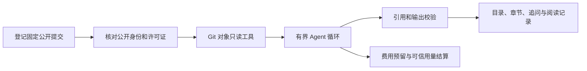

# 项目学习证据助手

面向公开 Java 后端项目的本地源码学习 Agent。通过受控查找、搜索与片段读取生成项目目录、章节正文和追问，将解释关联到固定 Git 提交及具体源码行。

项目提供 FastAPI 后台、原生网页、SQLite 存储和自定义 Agent 循环，技术栈为 Python 3.12、FastAPI、Pydantic、HTTPX、SQLite、JavaScript。

## 当前进度

这是可运行的开发版本。已实现公开版本核验、文件工具、任务历史、四类主题的章节与正文入口、追问、证据保存、阅读位置和模型费用控制。默认启动可以登记项目、核验公开来源、查阅源码与保存证据。

真实模型开发试验覆盖查询、提交、消息消费、判题。最新 F03 追问试验通过引用规划，正文阶段因返回 JSON 语法错误终止，未发布正文。完整固定题集、检索基线对比和 V1 验收仍在进行。自动化测试和模拟模型测试用于验证工程行为，真实模型质量按逐题结果记录。

## 本机启动

需要 Python 3.12 和 Git。当前依赖锁定基于 Windows。

```powershell
git clone https://github.com/chiye0384-dot/project-evidence-assistant.git
Set-Location project-evidence-assistant
py -3.12 -m venv .venv
& .\.venv\Scripts\python.exe -m pip install -r requirements.lock.txt
& .\.venv\Scripts\python.exe -B run.py
```

浏览器打开 <http://127.0.0.1:8765>。端口占用时可运行 `run.py --port 8766`。

默认启动无需模型 Key。登记一个本机普通 Git 仓库，填入其公开 GitHub URL 和完整 40 位提交，手动核对公开版本后即可使用只读工具。核对需要匿名访问 GitHub，API 限流时会核对官方公开网页。演示材料可选 [ForgeOJ](https://github.com/chiye0384-dot/ForgeOJ) 的公开固定版本。ForgeOJ 是学习材料，本仓库实现学习助手自身。

收费模型入口保留为实验功能，见 [模型配置](docs/model-configuration.md)。使用者的密钥、实时价格凭据、费用授权和数据库保存在各自本机。

## 执行流程



- 源码身份通过提交、树、blob 和内容摘要核对，行号与版本随证据保存。
- 工具执行检查路径、链接、类型、大小、数量和截断，源码只取固定 Git 对象。
- Agent 约束调用次数、工具次数、时间、上下文、输出和费用。两阶段追问先冻结引用，再生成对应正文。
- 可信供应商 usage 用于结算。请求结果不确定时保留费用预留，后续调用受门禁控制。
- 任务取消、来源变化、版本切换和重开均有持久化状态，旧证据与正文可回查。

## 验证

安装锁定依赖后运行独立测试集。

```powershell
& .\.venv\Scripts\python.exe -B -m pytest -q
node tests/frontend-list-race.cjs
node tests/frontend-agent-tasks.cjs
node tests/frontend-learning.cjs
```

测试使用临时 Git 仓库、合成源码和模拟 HTTP，覆盖源码边界、Agent 终止、章节保存、费用结算、接口隔离与前端异步状态。查看 [验证记录](docs/verification.md) 获取本次独立副本的结果与范围。

## 代码入口

| 入口 | 职责 |
| --- | --- |
| `src/project_evidence/app.py` | 本机 HTTP API 和网页 |
| `source.py`、`source_service.py`、`tools.py` | 公开来源、固定 Git 对象和受控工具 |
| `agent_engine.py`、`agent_protocol.py` | Agent 循环、预算和行动合同 |
| `task_service.py`、`task_storage.py` | 任务生命周期与持久化 |
| `deepseek_adapter.py`、`spending.py` | 模型请求、预留和用量结算 |
| `followup_two_phase.py`、`learning_contract.py` | 冻结引用与正文校验 |
| `static/` | 原生 JavaScript 网页 |

版本化实验目录与本机历史账本保留在开发工作区，本仓库提供独立的源码和核心测试快照。第三方依赖说明见 [THIRD-PARTY.md](THIRD-PARTY.md)。
